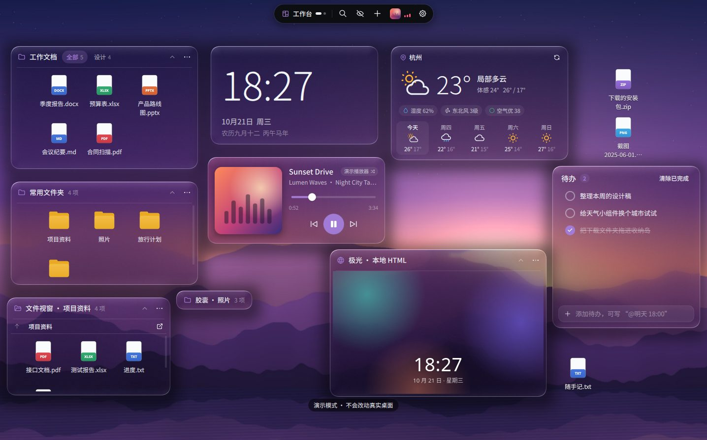
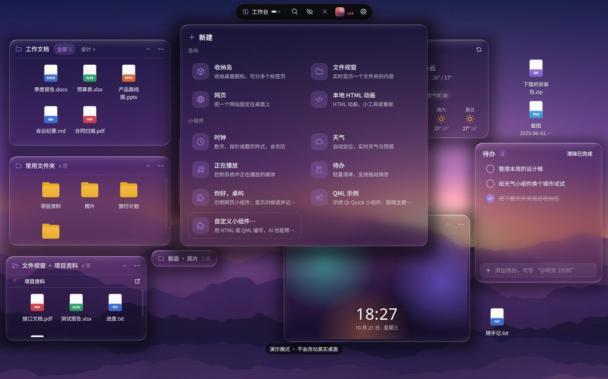
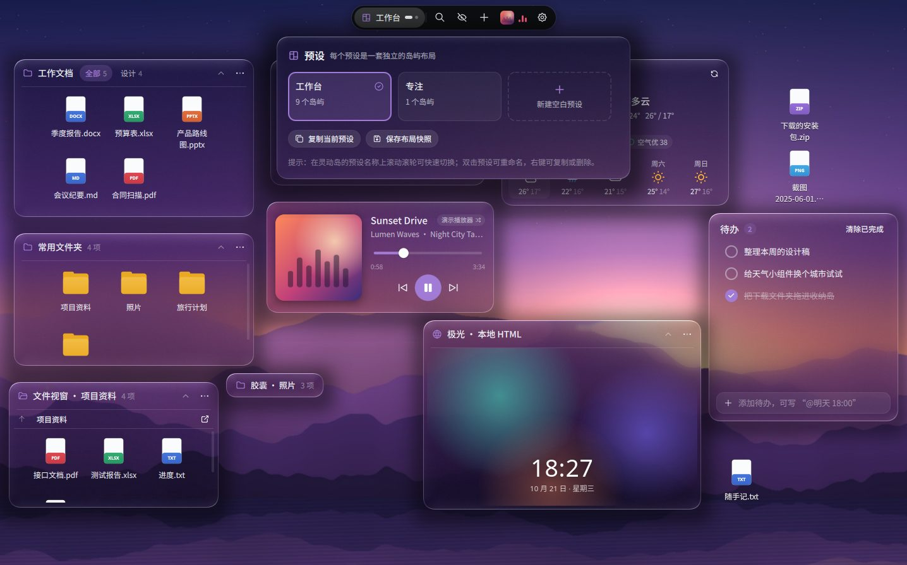
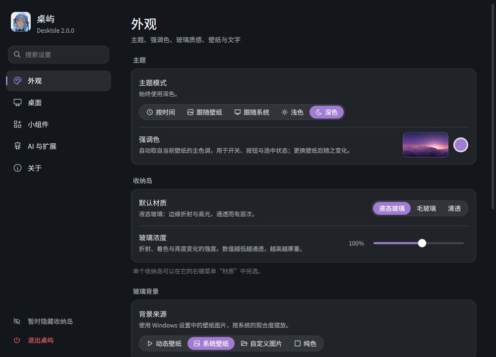
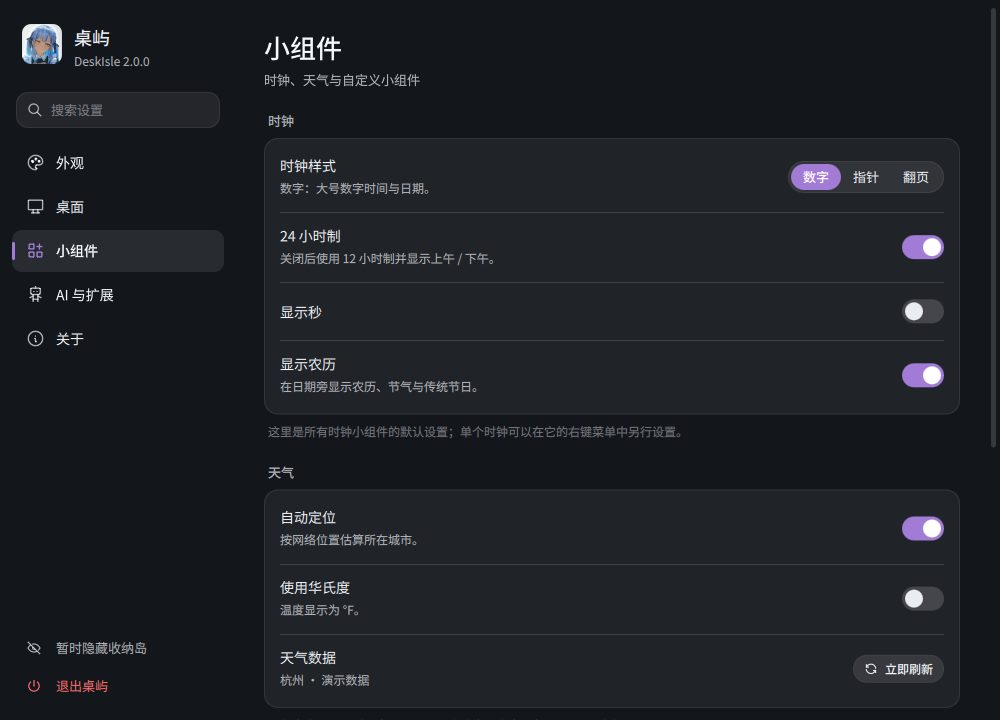

# 桌屿 DeskIsle

把凌乱桌面整理成你的工作岛。DeskIsle 是一个本地优先的 Windows 桌面整理器：桌面图标被收进一个个
会折射壁纸的玻璃“收纳岛”，时钟、天气、正在播放、待办和网页也能作为岛放在桌面上；
AI 助手可以通过 MCP 或命令行帮你整理。使用 Python 3 + PySide6（Qt Quick）编写。



> 普通“收纳岛”只保存文件**引用**，从不移动、重命名或删除原文件。

## 2.0 亮点

2.0 是最后一个大版本；当前为 2.0.1 修订版（实机反馈的修复与手感优化），完整变化见 [CHANGELOG.md](CHANGELOG.md)。

- **Qt Quick 全新界面**：每台显示器一个 GPU 绘制的透明图层；液态玻璃 / 毛玻璃 / 清透三种材质
- **动态壁纸玻璃**：默认实时读取桌面壁纸层的画面（含动态壁纸），每个岛折射它背后的那一块；强调色只取自壁纸
- **灵动岛与非模态面板**：新建、预设、搜索、正在播放都从顶部灵动岛展开，随时可收回
- **小组件**：时钟（数字 / 指针 / 翻页、24/12 小时制、农历节气）、天气（Windows 定位 + MSN 天气，Open-Meteo 备用）、
  正在播放（系统媒体会话）、待办（“@明天 18:00”式截止时间），以及用 HTML / QML 编写的自定义小组件
- **桌面管理**：收纳岛永不重叠并自动让位；按显示器组合记忆布局；胶囊模式悬停预览；双击桌面空白处隐藏 / 唤回；
  守护进程；Everything 全盘搜索；图标可直接拖到资源管理器
- **网页岛**：Microsoft Edge WebView2 合成模式，网页嵌在玻璃里
- **AI 与扩展**：MCP 服务器、`deskisle-cli` 命令行（62 条命令）、可热重载的自定义文件夹；
  删除等破坏性操作必须由你在桌面上确认

| 新建面板 | 排布预设 |
| --- | --- |
|  |  |
| **设置 · 外观** | **设置 · 小组件** |
|  |  |

## 系统要求

- Windows 10 / 11，64 位（推荐 Windows 10 1809 及以上：正在播放与定位依赖的系统接口从这一版起提供）
- 网页岛与 HTML 小组件需要 **Microsoft Edge WebView2 运行时**（Windows 11 与多数 Windows 10 已自带；
  缺少时岛内会显示下载链接，也可从 https://developer.microsoft.com/microsoft-edge/webview2/ 下载“常青版引导程序”）
- 可选：[Everything](https://www.voidtools.com)（安装并运行后，搜索面板直接使用它的索引）
- 从源码运行：Python 3.10 – 3.13

## 安装

运行 `DeskIsle-Setup-2.0.1-x64.exe`。默认安装到 `%LOCALAPPDATA%\Programs\DeskIsle`，不需要管理员权限。
安装向导可勾选“创建桌面快捷方式”和“把命令行工具 deskisle-cli 加入 PATH”；开机自动启动在
“设置 → 桌面 → 启动与性能”中打开。

从 1.x 升级时直接覆盖安装即可：首次启动会把旧布局备份为“升级到2.0之前的布局”快照，再自动迁移。

## 从源码运行

```powershell
python -m pip install -r requirements.txt
python main.py
```

演示窗口（使用 `%TEMP%\DeskIsleDemo` 中的示例文件与独立数据，不挂接、不改动真实桌面）：

```powershell
python main.py --demo
```

| 参数 | 作用 |
| --- | --- |
| `--demo` | 以普通窗口运行演示布局 |
| `--data-dir <目录>` | 使用其他数据目录（也可设置环境变量 `DESKISLE_DATA_DIR`） |
| `--reset` | 先备份，再重建默认布局 |
| `--verbose` | 在控制台输出详细日志 |
| `--mcp` | 作为 MCP 服务器运行（stdio），供 AI 助手连接 |
| `--cli <命令> …` | 向正在运行的桌屿发送一条命令（与 `deskisle-cli` 相同） |
| `--version` | 显示版本 |

macOS / Linux 可以运行 `--demo` 预览界面（网页岛需要另装 `PySide6-WebEngine`），桌面挂接、动态壁纸、
正在播放、定位、Everything 与全局快捷键只在 Windows 上可用。

## 快捷键

| 快捷键 | 作用 |
| --- | --- |
| `Ctrl+Alt+Space` | 聚焦层：临时把所有收纳岛置于窗口之上，再按一次或 `Esc` 退出 |
| `Ctrl+Alt+H` | 显示 / 隐藏桌面内容（双击桌面空白处也可以） |
| `Ctrl+Alt+←` / `Ctrl+Alt+→` | 上一个 / 下一个排布预设 |
| `Ctrl+Alt+Z` | 撤销上一次排布 |
| `Ctrl+Alt+F` | 搜索（装有 Everything 时搜索全盘） |
| `Ctrl+滚轮` | 在文件收纳岛中放大 / 缩小图标 |

全局快捷键可在“设置 → 桌面 → 唤醒与快捷键”中关闭。

## AI 助手（MCP 与命令行）

“设置 → AI 与扩展”显示本机可直接复制的 MCP 配置。安装版的配置形如：

```json
{
  "mcpServers": {
    "deskisle": {
      "command": "C:\\Users\\<你>\\AppData\\Local\\Programs\\DeskIsle\\deskisle-cli.exe",
      "args": ["mcp"]
    }
  }
}
```

把它加入 Claude Desktop、Cursor、VS Code、Cherry Studio 等支持 MCP 的客户端即可（源码运行时为
`python main.py --mcp`）。命令行示例：

```powershell
deskisle-cli list                                   # 全部命令，! 表示需要你确认
deskisle-cli help island.create                     # 某条命令的参数
deskisle-cli desk.state
deskisle-cli island.create --kind widget --widget clock --json '{"config": {"style": "split"}}'
deskisle-cli todo.add --uid <待办岛 uid> --text "交周报 @明天 18:00"
```

- 只通过本机命名管道通信，不开放网络端口；可在设置中随时关闭“允许 AI 助手控制桌屿”。
- 删除收纳岛 / 预设 / 标签页 / 待办 / 自制小组件、恢复快照、导入布局、退出桌屿等操作，会在桌面上弹出
  标有“来自 AI 助手”的确认卡片，由你决定是否执行。
- 给 AI 读的完整说明：[deskisle/agent/GUIDE.md](deskisle/agent/GUIDE.md)（命令参考由 `tools/gen_guide.py` 生成）。
- 修改代码的 AI 编程助手请先读 [AGENTS.md](AGENTS.md)。

## 自定义文件夹

默认位于 `%LOCALAPPDATA%\DeskIsle\custom`（可在“设置 → 小组件”中更换），保存后立即生效：

```
custom/
  README.md            说明（只在首次创建，不会覆盖）
  theme.json           视觉参数：圆角、玻璃强度、阴影、动画倍速、字号倍数、标题栏高度……
  widgets/<id>/        自定义小组件：widget.json + index.html（WebView2）或 Widget.qml
```

HTML 小组件通过 `window.deskisle` 读取主题与配置、保存设置、打开链接和发送通知；QML 小组件可以使用
`Theme`、`Clock`、`Weather`、`Player`、`Todo` 等对象。详见 [docs/使用说明.md](docs/使用说明.md#自定义小组件) 与
[AGENTS.md](AGENTS.md#自定义文件夹与小组件-sdk)。

## 数据位置

默认保存在 `%LOCALAPPDATA%\DeskIsle`（演示模式为 `%TEMP%\DeskIsleDemo`）。可用 `--data-dir` 或
`DESKISLE_DATA_DIR` 指定独立目录。

| 位置 | 内容 |
| --- | --- |
| `state.json`、`state.json.bak` | 布局与设置（原子写入，保留上一份备份） |
| `snapshots/` | 布局快照；从 1.x 升级时的 `<时间>--升级到2.0之前的布局.json` 也在这里 |
| `media/` | 导入的背景图片 / 视频副本（200 MB 以内复制，更大的直接引用原路径；不再被引用的副本启动时清理） |
| `fonts/` | 导入的字体文件副本 |
| `web/WebView2/` | 网页岛的登录状态（Cookie）与缓存；`web/composition.*` 记录合成模式是否可用 |
| `custom/` | 自定义文件夹（主题参数与自定义小组件） |
| `agent.json` | 正在运行的实例的命名管道名称，供 `deskisle-cli` 与 MCP 查找 |
| `screenshots/` | AI 助手调用 `app.screenshot` 生成的截图 |
| `update.json` | 更新检查记录（上次检查时间、已跳过的版本） |
| `deskisle.log`、`crash.log` | 运行日志与崩溃信息（“设置 → 关于 → 运行日志”可直接打开） |
| `running.marker`、`watchdog.json` | 守护进程用来判断是否意外退出、限制重启次数 |

安装新版本和卸载都不会删除这个目录。

## 隐私

DeskIsle 不包含任何遥测或使用统计，布局数据只保存在本机。只有下列情况会联网：

- **天气**（只在桌面上有天气小组件时）：请求 MSN 天气（`api.msn.com`，与 Windows 任务栏天气相同），
  不可用时改用 Open-Meteo（`api.open-meteo.com`）；在设置里搜索城市时使用 Open-Meteo 地理编码。
  发送的经纬度只保留两位小数（约 1 公里）。自动定位使用 Windows 定位服务，需要在 Windows“设置 → 隐私和安全性 →
  定位”中允许；没有位置时由 MSN 按网络（IP）位置估算。关闭“自动定位”后只使用你选择的城市。
- **检查更新**：大约每 20 小时最多一次，请求 `api.github.com` 读取 `narabias/DeskIsle` 的最新发布信息；
  可在“设置 → 关于”中关闭自动检查。只有点击“下载并安装”后才会下载安装包，并校验 SHA-256。
- **网页岛**：访问你填写的网址，和普通浏览器一样。
- **本地 HTML 动画与 HTML 小组件**：默认禁止联网，只能读取本地文件；需要时可单独允许。

正在播放只读取 Windows 本机的媒体会话；Everything 搜索通过本机进程间通信完成；AI 接口只监听本机命名管道。
普通收纳岛只记录文件路径引用，**从不移动、重命名或删除**被引用的文件；只有文件视窗中的复制 / 移动会真正操作文件，
且执行前会明确确认。

## 项目结构

```
main.py                    程序入口、命令行参数（--demo / --mcp / --cli / --self-test …）
deskisle/
  models.py                数据模型、序列化与 1.x → 2.0 迁移
  storage.py               原子写入、备份、快照、导入导出
  rules.py                 归流规则引擎
  layout.py                收纳岛排布几何（不重叠、间距、让位），不依赖 Qt
  monitors.py              显示器与预设的对应关系、显示器组合
  custom.py                自定义文件夹（theme.json、自定义小组件，热重载）
  demo.py                  演示布局与示例文件
  updater.py               GitHub 更新检查、下载与 SHA-256 校验
  watchdog.py              崩溃守护进程（不依赖 Qt）
  native_win.py            Win32：桌面挂接、热键、图标、Shell 操作（平台隔离）
  webview2.py              WebView2 COM 接口的 ctypes 绑定（含合成模式）
  shell_menu.py            Explorer 原生右键菜单（独立进程）与 shell_context.py
  selftest.py              打包后 EXE 自检
  engine/                  Qt Quick 引擎层
    app.py                 启动、QML 引擎、图像提供器、窗口生命周期
    controller.py          DeskController（QML 中的 Desk）：手势、操作、预设、通知、确认
    scene.py               每台显示器的场景模型、收纳岛代理、图标模型
    arrange.py             拖动 / 缩放时的实时让位、交换与撤销
    layer.py               每台显示器的图层窗口、置顶岛窗口
    desk_items.py          图标列表、拖放、拖出到资源管理器
    wallpaper.py           壁纸来源（动态 / 静态 / 图片 / 纯色）与强调色
    style.py               主题（QML 中的 Theme）与视觉参数
    icons.py               文件图标提供器（image://icon）
    menus.py               所有右键菜单的构建与分发
    webhost.py             网页岛宿主（WebView2 合成 / 窗口模式）
    system.py              托盘、全局快捷键、前台窗口与桌面双击钩子、守护
  services/                小组件后端：clock（农历）、weather、nowplaying、everything、todo
  agent/                   AI 接口：schema（命令定义）、commands、server（命名管道）、client、mcp、cli、GUIDE.md
  qml/                     全部界面：Layer、Island、DynamicBar、各面板、Settings*、小组件、Glass 与着色器
  assets/                  应用图标、演示壁纸与 HTML、WebView2Loader.dll
packaging/                 PyInstaller spec、Inno Setup 脚本、应用图标
tools/                     构建脚本、命令参考生成（gen_guide.py）、截图探针（probe.py）等
tests/                     单元测试与界面测试
docs/                      使用说明、打包说明、截图
```

## 测试

```powershell
python -m unittest discover -s tests -v
```

测试会自动使用独立的临时数据目录并禁用 WebView2（`DESKISLE_DISABLE_WEBVIEW2=1`），网页岛显示占位内容；
WebView2 的 COM 交互由 `tests/test_v13_webview2.py` 中的模拟对象覆盖。无显示器的环境可设置
`QT_QPA_PLATFORM=offscreen`。修改命令定义后运行 `python tools/gen_guide.py` 更新 GUIDE.md 中的命令参考。

## 构建安装包

```powershell
# 双击 build-release.bat，或：
powershell -File tools/build_release.ps1 -NoOpen
```

脚本会安装依赖、运行测试、检查命令参考、用 PyInstaller 打包（`DeskIsle.exe`、`deskisle-cli.exe`、
`DeskIsleShellMenu.exe`）、编译 Inno Setup 安装程序，并用 `--self-test` 验证真实 EXE。
产物：`dist/installer/DeskIsle-Setup-<版本>-x64.exe` 及同名 `.sha256`。详见 [docs/打包说明.md](docs/打包说明.md)。

## 许可

本项目代码以 **MIT 许可**发布，见 [LICENSE](LICENSE)。打包产物包含 PySide6/Qt（LGPLv3）等第三方组件，
界面图标来自 Tabler Icons（MIT），详见 [THIRD-PARTY-NOTICES.md](THIRD-PARTY-NOTICES.md)。
